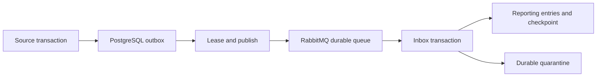

# Messaging and financial reporting

This increment delivers stored outbox events to RabbitMQ and maintains an eventually consistent financial reporting projection through a durable inbox. Financial source ledgers, period closing and reversals remain local atomic transactions; broker delivery does not perform another financial posting.

## Enable the workers

Apply migrations before starting an enabled worker:

```powershell
dotnet ef database update --project src/Vat.Infrastructure --startup-project src/Vat.Api
$env:Messaging__Enabled = 'true'
$env:Messaging__Uri = '<broker URI from your secret configuration>'
dotnet run --project src/Vat.Api
```

Messaging defaults disabled so the API can start without a broker. `Posting__Enabled` is independent. Use `amqps://` for a remote broker; plaintext `amqp://` is accepted only on loopback. URI credentials must come from environment/user secrets, not committed settings. The default-vhost path can be encoded as `/%2F`. Give the application access only to its intended vhost/exchange/queue. Broker publishers are trusted infrastructure, not end-user clients.

| Setting | Default | Meaning |
|---|---|---|
| Messaging__Enabled | false | Starts publisher and reporting-consumer loops. |
| Messaging__Uri | unset | Secret AMQP(S) connection URI. |
| Messaging__Exchange | vat.events.v1 | Durable topic exchange. |
| Messaging__ReportingQueue | vat.reporting.v1 | Durable quorum queue, bound to all current event routes. |
| Messaging__BatchSize | 25 | Maximum claims per dispatch tick, 1-100. |
| Messaging__PollSeconds | 2 | Tick interval, 1-60 seconds. |
| Messaging__PublishTimeoutSeconds | 15 | Confirmation timeout, 1-60 seconds. |
| Messaging__LeaseSeconds | 60 | Database claim lifetime; at least confirmation timeout + 10 seconds, max 300. |
| Messaging__MaxAttempts | 8 | Attempts before outbox quarantine, 1-20. |

Topology declarations are idempotent for this exact configuration. A pre-existing classic queue with the same name as the configured quorum queue is incompatible; use a new queue name and a controlled consumer cutover. A one-node quorum queue in CI verifies protocol behavior, not high availability.

## Delivery and recovery behavior



Claims use `FOR UPDATE SKIP LOCKED`, short database transactions and expiring tokens. Publishing uses persistent messages, mandatory routing and tracked publisher confirmations. The row is marked delivered only after publish succeeds and only by its current lease owner. Nack, return, timeout or unavailable transport keeps the row retryable. Attempts back off exponentially; exhausted attempts are quarantined. A crashed worker's lease expires, permitting another worker to resume. TotalAttempts remains available across operator retries.

A broker confirmation proves broker acceptance, not successful reporting. A crash after broker acceptance but before the database delivery marker can publish a duplicate. This is expected at-least-once delivery.

The consumer acknowledges only after its inbox/projection transaction, or its durable quarantine transaction, commits. Transient processing/database failures leave the delivery unacknowledged; connection disposal requeues it and the worker reconnects with a delay. Known non-financial notifications are durably recorded as Ignored. Unsupported schemas/events, malformed data, identity conflicts and invalid monetary payloads go to PostgreSQL quarantine before acknowledgement. This is an application quarantine, not a separate RabbitMQ DLQ.

Inbox identity is `(reporting-v1, eventId)` with an exact payload-byte hash. An altered copy using the same event ID is quarantined. Financial business identity is additionally `(tenantId, companyId, transactionId)`; an equivalent transaction under another event ID does not add totals twice, while conflicting content is quarantined. Reporting writes serialize per company; source posting continues independently.

## Projection contract

Posting and full reversal now each emit `FinancialEntryRecordedV1` in the existing integration envelope. Its [versioned schema](contracts/financial-entry-recorded-v1.schema.json) carries transaction/purchase/branch/warehouse identities, business date, external reference, currency, signed amounts and optional original transaction reference.

Original transaction ID is the immutable posting-plan ID. Correcting transaction ID is the immutable reversal-request ID. Reversals negate the frozen original values and use their own correction date. They can arrive before originals: reporting stores immutable signed transactions and sums them rather than incrementing mutable document status. There is deliberately no foreign key requiring original arrival first. Original ledger notifications remain separate and are not counted again.

Amounts use BDT and the current four-decimal financial policy. No tax rate or credit eligibility is recalculated by a consumer. These reports are operational projections, not certified returns or filing receipts.

## Reporting API

All routes below start with `/api/v1/companies/{companyId}` and enforce signed company scope. GETs require `report.read`:

- `/reports/financial-summary?from=2026-10-01&until=2026-11-01`
- `/reports/financial-entries?from=2026-10-01&until=2026-11-01&take=25`

Dates use [from, until). Entry pages accept the last transaction UUID as `before`; max take is 100. Counts represent financial transactions, including corrections. A fully reversed purchase therefore contributes two transactions and zero signed total when both dates are in the requested range.

Summary freshness is company-wide and includes LastProcessedAt, LatestObservedEventAt, UnprocessedFinancialEvents, QuarantinedMessages and IsCaughtUp. LatestObservedEventAt is a maximum observed timestamp, **not** a contiguous event watermark. IsCaughtUp remains false while a local financial outbox event lacks a processed inbox record, an unresolved company quarantine exists, or legacy posted source transactions lack reporting entries. DispatchedAt alone never makes a report current. Report reads use a consistent database snapshot.

## Backfill and rebuild

POSTs require `report.manage`, a UUID Idempotency-Key and `{ "reason": "Reviewed operation reason" }`:

- `/reports/backfill`: validates/reconciles local posted sources and schedules missing financial events for originals and completed reversals. It preserves historical business/correction dates and source posting versions. Repeated scheduling does not duplicate already stored events. It does not modify source ledgers or report totals synchronously.
- `/reports/rebuild`: atomically removes this company's reporting entries, reporting inbox/checkpoint and resets its stored financial events for redelivery. Source ledgers and frozen period checkpoints remain intact. Freshness is incomplete until events are consumed again. Run backfill first for sources created before this event existed.

Both operations are audited. The rebuild only resets the currently supported reporting-v1 consumer. Stored event retention is required for replay; do not delete outbox/inbox history without an approved retention/rebuild policy. Old aggregate versions are preserved in backfill; the newly scheduled event's OccurredAt reflects scheduling time, while its BusinessDate remains historical.

## Message operations

Read routes require `messaging.read`; retry/replay require `messaging.retry`. All POSTs need the standard idempotency UUID and a reason.

| Method and route | Behavior |
|---|---|
| GET `/messaging/outbox?take=25&before={lastId}` | Scoped dispatch state, attempt counters, leases indirectly through retry eligibility, sanitized error codes and quarantine time. |
| POST `/messaging/outbox/{id}/retry` | Requeues a failed/quarantined undelivered message; rejects active leases and already delivered rows. Preserves lifetime attempt count. |
| GET `/messaging/dead-letters?take=25&before={lastId}` | Scoped quarantine diagnostics; does not expose payload bytes or credentials. |
| POST `/messaging/dead-letters/{id}/replay` | Processes the stored immutable payload again through the same validator/inbox transaction. Returns actual Processed/Duplicate/Ignored/Quarantined status. |

Replay does not edit a bad payload or bypass schema validation. Unsupported data remains Quarantined until compatible code/contracts are deployed. Messages exceeding 1 MiB retain only a bounded payload and cannot be replayed. Completely malformed events with no valid tenant/company are retained for infrastructure-owner diagnosis; tenant-facing APIs do not expose globally unscoped quarantine.

Broker-side redelivery can be unbounded during database outage because no acknowledgement is issued. Malformed events are quarantined once storage is available, avoiding a hot poison-message requeue loop. Logs omit broker URIs and raw message bodies. Production monitoring should alert on pending age, growing quarantine and repeated reconnects; `/health/ready` currently checks database/migrations, not broker or projection freshness.

## Verification and CI

Run `scripts/Test-Local.ps1` for real PostgreSQL tests. Inbox/projection commits, duplicates, ordering, leases, failed publishing, retry and rollback use PostgreSQL with an explicit test publisher; they do not claim live broker coverage.

Set `VAT_TEST_RABBITMQ_URI` to a disposable RabbitMQ 4 broker to enable the two live transport tests. These use unique exchange/queue names and test confirmed delivery, requeue after handler failure and mandatory unroutable rejection. Without this variable they are explicitly skipped. GitHub CI now provisions PostgreSQL and RabbitMQ, but the remote workflow has not been executed from this workspace.
